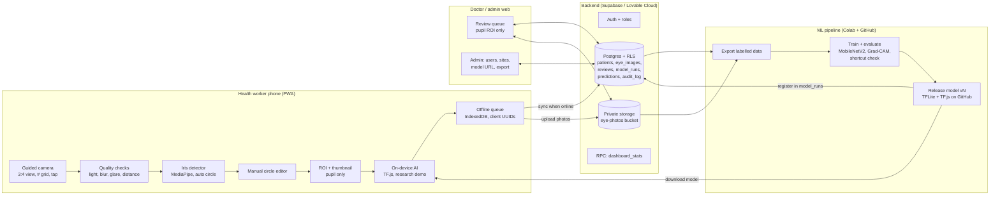
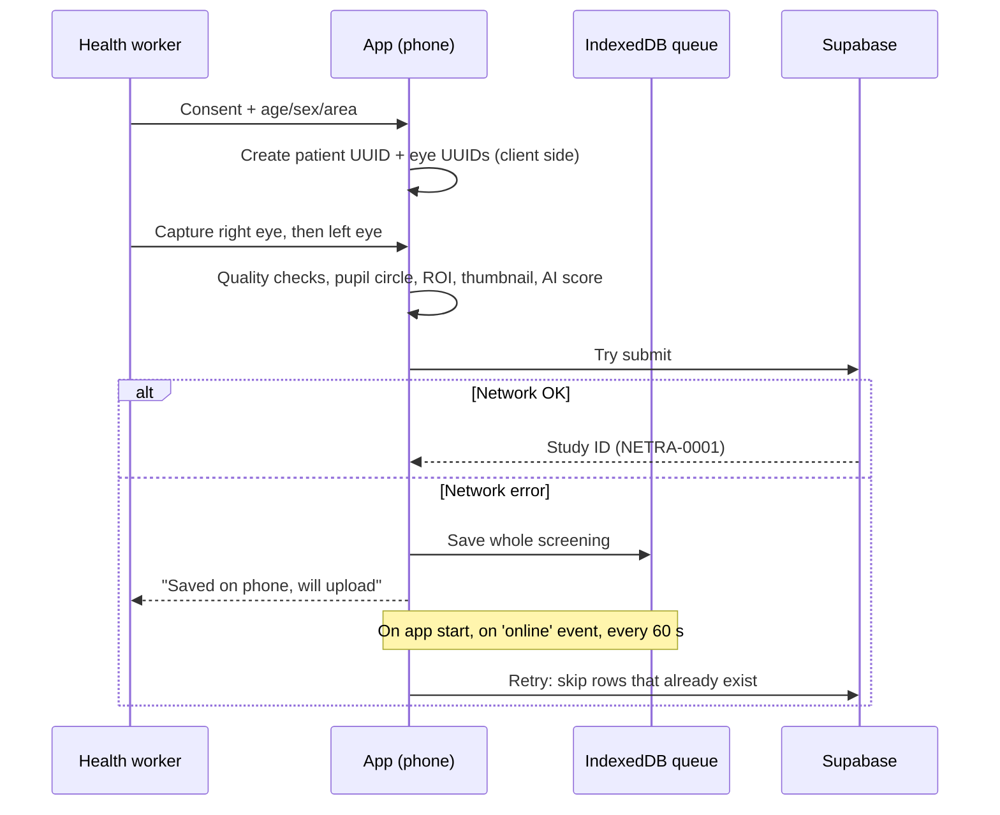
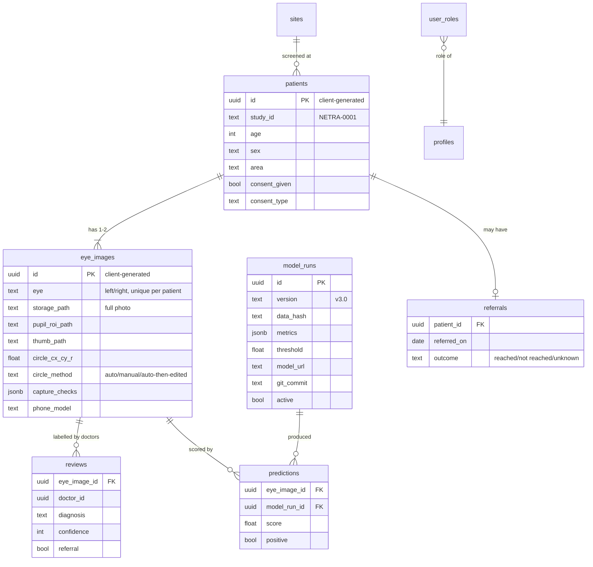

# Netra AI — System Design Document (v0.1)
# নেত্র এআই — সিস্টেম ডিজাইন ডকুমেন্ট

**Author:** Arijit Das Gupta · **Date:** October 2026 · **Status:** Draft for review by supervisors and ophthalmologists
**Live research app:** https://netra-ai-bd.lovable.app · **Code:** github.com/arijitdasgupta543-dev/netra-ai-bd

> Research prototype, not a medical device. AI output is a screening aid only; every suspected case is referred to a qualified eye-care professional.
> **বাংলা:** এটি গবেষণার প্রোটোটাইপ, চিকিৎসা যন্ত্র নয়। AI শুধু স্ক্রিনিংয়ে সাহায্য করে; সন্দেহজনক প্রতিটি রোগীকে চক্ষু বিশেষজ্ঞের কাছে পাঠানো হয়।

How to read this document: each section has the English text first (for professors and reviewers), then a **বাংলা** summary.
**বাংলা:** প্রতিটি অংশে আগে ইংরেজি (প্রফেসরদের জন্য), তারপর বাংলা সারাংশ।

---

## 1. Purpose and scope / উদ্দেশ্য ও পরিধি

Netra AI lets community health workers in rural Bangladesh photograph the front of the eye with an ordinary smartphone. The app checks photo quality, isolates the pupil, records an optional AI screening score, and sends the case for ophthalmologist labelling and referral. The same pipeline builds a clean, labelled dataset for training better models.

This document covers the field app, the backend, the doctor review loop and the ML lifecycle. It does not cover hospital EMR integration or regulatory certification, which come after a validated pilot.

**বাংলা:** স্বাস্থ্যকর্মী সাধারণ ফোনে চোখের ছবি তোলেন। অ্যাপ ছবির মান যাচাই করে, শুধু মণির অংশ আলাদা করে, AI স্কোর রাখে, আর ডাক্তারের কাছে লেবেল ও রেফারের জন্য পাঠায়। একই পথে ট্রেনিংয়ের জন্য পরিষ্কার, লেবেলযুক্ত ডেটাসেট তৈরি হয়। হাসপাতালের সিস্টেমের সাথে সংযোগ আর সরকারি অনুমোদন পাইলটের পরে।

---

## 2. Users and requirements / ব্যবহারকারী ও চাহিদা

### 2.1 Users / ব্যবহারকারী

| Role | Main job | Device |
|---|---|---|
| Health worker | Consent, capture both eyes, submit | Low/mid-range Android, often offline |
| Doctor (ophthalmologist) | Label photos, decide referral | Phone or laptop |
| Admin / researcher | Manage users and sites, export data, set model | Laptop |
| ML pipeline (Arijit) | Train, evaluate and release models | Colab |

**বাংলা:** চার ধরনের ব্যবহারকারী: স্বাস্থ্যকর্মী (ছবি তোলেন, প্রায়ই নেট থাকে না), ডাক্তার (লেবেল ও রেফার), অ্যাডমিন (ইউজার, সাইট, ডেটা এক্সপোর্ট), আর ML পাইপলাইন (আপনি, Colab-এ ট্রেনিং)।

### 2.2 Functional requirements / কী কী কাজ করবে

| ID | Requirement | Status |
|---|---|---|
| F1 | Record consent (verbal/written) and de-identified Study ID | ✅ Done |
| F2 | Guided capture: compact 3:4 camera, # grid, tap to capture, light/blur/distance warnings | ✅ Done |
| F3 | Pupil circle: automatic (MediaPipe iris) or manual editor; method saved | ✅ Done |
| F4 | Pupil-only view: no face shown after capture | ✅ Done |
| F5 | Work offline; upload automatically later without duplicates | ✅ Done (needs field test) |
| F6 | Doctor review: diagnosis, confidence 1–5, referral | ✅ Done |
| F7 | Export labelled data (CSV + images) for training | ✅ Done |
| F8 | AI screening score labelled "Research demo" | ⚠️ Model URL not yet set |
| F9 | Record which model version produced each score | ❌ To do (`model_runs`, `predictions`) |
| F10 | Audit log of who changed what | ❌ To do (`audit_log`) |
| F11 | Referral tracking: did the patient reach the eye clinic? | ❌ To do (`referrals`) |

**বাংলা:** F1–F7 অ্যাপে করা আছে। F8-এ মডেলের লিংক বসানো বাকি। F9 (কোন মডেল ভার্সন স্কোর দিল), F10 (কে কী বদলাল তার লগ) আর F11 (রোগী সত্যিই চোখের ক্লিনিকে গেল কিনা) এখনো করতে হবে।

### 2.3 Non-functional requirements, in priority order / মান-সংক্রান্ত চাহিদা (অগ্রাধিকার অনুযায়ী)

1. **Offline-first:** no screening may be lost because of bad network.
2. **Privacy:** no names in research data; only pupil crops shown to reviewers; private storage.
3. **Runs on cheap phones:** about 2 GB RAM Android, slow 3G.
4. **Trustworthy data:** every photo traceable to device, worker, method, model version and label.
5. **Scale:** 1,000 workers without redesign.
6. **Speed:** capture-to-submit under 2 minutes per patient.

When two goals conflict, the higher one wins. Example: we accept a slower upload (rule 1) rather than block the worker until the network returns.

**বাংলা:** দুটো লক্ষ্যে টানাটানি হলে উপরেরটা জিতবে। ক্রম: (১) নেট ছাড়া কাজ, (২) গোপনীয়তা, (৩) সস্তা ফোনে চলা, (৪) নির্ভরযোগ্য ডেটা, (৫) ১০০০ কর্মী পর্যন্ত বাড়ানো, (৬) গতি।

---

## 3. Capacity estimates / ক্ষমতার হিসাব

Assumptions: 1,000 workers × 20 patients/day × 2 eyes; 26 working days/month; full photo 1600 px JPEG ≈ 400 KB; pupil ROI ≈ 50 KB; thumbnail ≈ 6 KB.

| Quantity | Value |
|---|---|
| Patients per day | 20,000 |
| Eye photos per day | 40,000 |
| Full photos, storage | 16 GB/day ≈ 416 GB/month |
| ROI + thumbnail, storage | 2.2 GB/day ≈ 58 GB/month ≈ 0.7 TB/year |
| Keep 10% of full photos as audit sample | ≈ 42 GB/month |
| Upload per worker per day | ≈ 18 MB (fine on 3G) |
| Average API load (8-hour day) | ≈ 0.7 screenings/s ≈ 4 requests/s (peak ×5 ≈ 20 req/s) |
| Doctor time to review every eye (30 s each) | ≈ 333 hours/day: **not feasible** |
| Triage: all AI-positive (≈25%) + 5% random negatives | ≈ 11,500 eyes ≈ 96 hours ≈ 16 doctor-days/day |
| Pilot (300 patients) | ≈ 275 MB total |

Conclusions:

- The **database and API are not the bottleneck**; Postgres handles this load easily.
- **Storage** is the main cost. Keep every ROI, but only a sample of full photos after a retention period.
- **Doctor time is the real bottleneck.** At scale, doctors cannot label everything. Use triage: review all AI-positive cases plus a random sample of negatives, so sensitivity can still be measured.
- The pilot fits easily in a small plan.

**বাংলা:** ডাটাবেস বা সার্ভার সমস্যা নয়। আসল খরচ স্টোরেজ: সব ছবি রাখলে মাসে প্রায় ৪১৬ GB, শুধু মণির ক্রপ রাখলে প্রায় ৫৮ GB। তাই সব ক্রপ রাখব, পুরো ছবি রাখব শুধু ১০% নমুনা। সবচেয়ে বড় সমস্যা ডাক্তারের সময়: সব চোখ দেখতে দিনে ৩৩৩ ঘণ্টা লাগবে। তাই AI যেগুলো সন্দেহজনক বলবে সেগুলো সব, আর বাকিগুলোর ৫% এলোমেলোভাবে ডাক্তার দেখবেন, যাতে AI কতগুলো ছানি মিস করছে তা মাপা যায়। পাইলটে (৩০০ রোগী) মাত্র ২৭৫ MB লাগবে।

---

## 4. Architecture / কাঠামো



| Layer | Technology now | Why |
|---|---|---|
| Client | React PWA (TanStack Start), MediaPipe, TF.js, IndexedDB | One codebase for phone and laptop, installable, no app-store delay |
| Backend | Supabase: Auth, Postgres with row-level security, private Storage | Managed, free to start, security in the database itself |
| ML | Colab (T4), TensorFlow, MobileNetV2 → TFLite / TF.js | Free GPU, small model fits cheap phones |
| Distribution | GitHub + jsDelivr for model files | Free, versioned, public for reproducibility |

**বাংলা:** চারটা স্তর। (১) **ফোন:** ক্যামেরা → মান যাচাই → মণি খোঁজা → হাতে ঠিক করা → শুধু মণির ক্রপ → AI স্কোর → অফলাইন সারি। (২) **সার্ভার:** লগইন, ডাটাবেস (RLS দিয়ে কে কী দেখবে তা নিয়ন্ত্রিত), প্রাইভেট ছবির স্টোরেজ। (৩) **ডাক্তার/অ্যাডমিন:** শুধু মণির ছবি দেখে লেবেল দেন; অ্যাডমিন ইউজার, সাইট, মডেল লিংক আর এক্সপোর্ট সামলান। (৪) **ML:** এক্সপোর্ট → Colab-এ ট্রেনিং ও যাচাই → নতুন ভার্সন GitHub-এ → ফোনে ডাউনলোড। তীরগুলোই আসল: তথ্য কোথা থেকে কোথায় যায়।

---

## 5. Key flows / প্রধান প্রবাহ

### 5.1 Screening and offline sync / স্ক্রিনিং ও অফলাইন সিঙ্ক



Idempotency: the patient and eye IDs are created on the phone, so a retry checks whether rows already exist and never creates duplicates.

**বাংলা:** রোগী ও চোখের ID ফোনেই তৈরি হয়। নেট না থাকলে পুরো স্ক্রিনিং ফোনে জমা থাকে। পরে অ্যাপ খুললে, নেট ফিরলে বা প্রতি ৬০ সেকেন্ডে আবার চেষ্টা করে। আগে থেকে থাকা রেকর্ড বাদ দেয়, তাই কখনো ডুপ্লিকেট হয় না।

### 5.2 Doctor review and referral / ডাক্তারের রিভিউ ও রেফার

1. The doctor opens the review queue and sees only the pupil ROI and quality data, never the face. Personal data is limited to age, sex and area.
2. The doctor chooses a diagnosis (normal / early / advanced cataract / other / ungradable), a confidence of 1–5 and whether to refer.
3. **Blinding:** the AI score is hidden from the doctor until the label is saved. Otherwise the label is biased and cannot be used to measure the AI.
4. For the research set, two doctors label independently; disagreements go to a third (adjudication).
5. Referral cases get a `referrals` row; the worker records whether the patient reached the clinic.

**বাংলা:** ডাক্তার শুধু মণির ছবি দেখেন, মুখ নয়। লেবেল দেওয়ার আগে AI স্কোর লুকানো থাকবে, না হলে লেবেল পক্ষপাতদুষ্ট হবে আর AI মাপা যাবে না। গবেষণার জন্য দুইজন ডাক্তার আলাদাভাবে লেবেল দেবেন, মতভেদ হলে তৃতীয়জন সিদ্ধান্ত দেবেন। রেফার করা রোগী ক্লিনিকে গেল কিনা, সেটাও রাখা হবে।

### 5.3 Model release / মডেল রিলিজ

1. Admin exports labelled data (only rows with a final label).
2. Colab notebook: de-duplicate → patient-level split (both eyes of one patient in the same split) → train → test with 95% CI → Grad-CAM → shortcut check.
3. If it beats the current model on the frozen test set, upload TFLite + TF.js files to GitHub with a version tag (`v3.0`).
4. Insert a `model_runs` row (version, data snapshot hash, metrics, threshold, file URL, git commit).
5. Admin activates the model; the phone downloads it; every new score is stored with `model_run_id`.

**বাংলা:** এক্সপোর্ট → Colab-এ ডুপ্লিকেট বাদ, একই রোগীর দুই চোখ একই ভাগে, ট্রেনিং, যাচাই, Grad-CAM → আগের মডেলের চেয়ে ভালো হলে GitHub-এ ভার্সন নম্বরসহ রাখা → `model_runs` টেবিলে রেকর্ড → অ্যাডমিন চালু করলে ফোনে ডাউনলোড। প্রতিটা স্কোরের সাথে কোন মডেল দিয়েছে তা লেখা থাকবে।

---

## 6. Data model / ডেটা মডেল



Existing tables: `profiles`, `user_roles`, `sites`, `patients`, `eye_images`, `reviews`, `settings`.
Proposed new tables: `model_runs`, `predictions`, `referrals`, `audit_log`.

Proposed SQL (to apply as migration `0006`):

```sql
CREATE TABLE public.model_runs (
  id uuid PRIMARY KEY DEFAULT gen_random_uuid(),
  version text NOT NULL UNIQUE,
  data_hash text, metrics jsonb, threshold double precision,
  model_url text NOT NULL, git_commit text,
  active boolean NOT NULL DEFAULT false,
  created_at timestamptz NOT NULL DEFAULT now()
);
CREATE TABLE public.predictions (
  id uuid PRIMARY KEY DEFAULT gen_random_uuid(),
  eye_image_id uuid NOT NULL REFERENCES public.eye_images(id) ON DELETE CASCADE,
  model_run_id uuid NOT NULL REFERENCES public.model_runs(id),
  score double precision NOT NULL, positive boolean NOT NULL,
  created_at timestamptz NOT NULL DEFAULT now(),
  UNIQUE (eye_image_id, model_run_id)
);
CREATE TABLE public.referrals (
  patient_id uuid PRIMARY KEY REFERENCES public.patients(id) ON DELETE CASCADE,
  referred_on date NOT NULL DEFAULT current_date,
  outcome text CHECK (outcome IN ('reached','not_reached','unknown')) DEFAULT 'unknown',
  updated_at timestamptz NOT NULL DEFAULT now()
);
CREATE TABLE public.audit_log (
  id bigserial PRIMARY KEY,
  at timestamptz NOT NULL DEFAULT now(),
  actor uuid DEFAULT auth.uid(),
  table_name text NOT NULL, row_id uuid, action text NOT NULL,
  old_data jsonb, new_data jsonb
);
-- + RLS: everyone with a role reads model_runs; admin writes it;
--   predictions inserted by the worker who created the eye image;
--   audit_log filled by triggers, readable by admin only.
```

**বাংলা:** এখনকার টেবিল: profiles, user_roles, sites, patients, eye_images, reviews, settings। নতুন চারটা লাগবে:

- `model_runs`: প্রতিটা মডেল ভার্সনের রেকর্ড (মেট্রিক, থ্রেশহোল্ড, ফাইলের লিংক)।
- `predictions`: কোন ছবিতে কোন মডেল কত স্কোর দিল।
- `referrals`: রোগী ক্লিনিকে গেল কিনা।
- `audit_log`: কে কখন কী বদলাল।

উপরের SQL মাইগ্রেশন `0006` হিসেবে চালানো যাবে।

---

## 7. Security and privacy / নিরাপত্তা ও গোপনীয়তা

| Control | How |
|---|---|
| De-identification | No name/phone/NID stored; Study ID only |
| Least privilege | Roles: health_worker, doctor, admin; row-level security on every table |
| Pupil-only access | Non-admins can read only pupil ROI / thumbnail objects; full photos are admin-only |
| Private storage | `eye-photos` bucket is private; signed URLs only |
| Consent | Consent flag required; written consent photo optional |
| Audit | `audit_log` triggers on patients, eye_images, reviews (to do) |
| Retention | Full photos deleted or archived after a set period; ROIs kept for research |
| Phone loss | Offline queue lives in app storage; log out clears it; queue items expire after N days |
| Ethics | IRB / ethics committee approval before patient data collection |

Open issue: migration `0005` relaxed the storage read policy so it no longer checks `pupil_circle_confirmed`. Decide whether unconfirmed ROIs may be shown, and restore the check if not.

**বাংলা:** নাম, ফোন নম্বর বা NID রাখা হয় না, শুধু Study ID। প্রতিটা টেবিলে RLS আছে: কর্মী, ডাক্তার, অ্যাডমিন যার যেটুকু দরকার শুধু সেটুকু দেখেন। পুরো ছবি শুধু অ্যাডমিন দেখতে পারেন, বাকিরা শুধু মণির ক্রপ। স্টোরেজ প্রাইভেট। কে কী বদলাল তার লগ রাখা বাকি। রোগীর ডেটা নেওয়ার আগে এথিক্স অনুমোদন লাগবে।

একটা খোলা সমস্যা: মাইগ্রেশন ০০০৫-এ নিশ্চিত না করা মণির বৃত্তও দেখা যাচ্ছে। এটা রাখবেন কিনা ঠিক করতে হবে।

---

## 8. ML lifecycle and monitoring / ML জীবনচক্র ও পর্যবেক্ষণ

**Rules / নিয়ম**

1. **Frozen test set:** a fixed set of doctor-labelled field images is never used for training. Every model version is compared on it.
2. **Patient-level split:** both eyes of the same patient stay in the same split, to avoid leakage. The audit found 54 leaked duplicate groups in the public dataset.
3. **Threshold for sensitivity:** choose the threshold on validation for sensitivity ≥ 0.95; report specificity with a 95% CI.
4. **Shortcut check:** compare against a model using only image size/colour. v1 reached 0.73 on that baseline; the real model must clearly beat it.
5. **Explainability:** run Grad-CAM on every release. The heat should sit on the pupil/lens, not on skin.
6. **Subgroups:** report results by phone model, site, lighting, age group and circle method.

**What to monitor in the field / মাঠে কী মাপবেন**

| Metric | Why | Target |
|---|---|---|
| Photo rejection rate by quality check | Camera guidance working? | < 15% |
| % ungradable by doctor | Is the capture good enough? | < 10% |
| Auto vs manual circle rate | Iris detector reliability | Auto ≥ 70% |
| Sensitivity on random-negative sample | Missed cataracts | ≥ 0.90 |
| Positive rate per site / phone | Drift or broken device | Stable week to week |
| Referral completion | Real-world impact | Track, then improve |
| Queue age (oldest unsent screening) | Sync health | < 48 h |

**বাংলা:**

- একটা নির্দিষ্ট টেস্ট সেট কখনো ট্রেনিংয়ে যাবে না, আর সব ভার্সন সেটাতেই তুলনা হবে।
- একই রোগীর দুই চোখ একই ভাগে থাকবে।
- থ্রেশহোল্ড এমনভাবে বাছবেন যাতে ছানি মিস কম হয় (sensitivity ≥ ০.৯৫)।
- প্রতিবার শুধু মাপ-রং দিয়ে বানানো মডেলের সাথে তুলনা করবেন (shortcut check) আর Grad-CAM দেখবেন।
- মাঠে কয়েকটা জিনিস মাপবেন: কত ছবি বাতিল হচ্ছে, ডাক্তার কত ছবিকে "দেখা যায় না" বলছেন, অটো বৃত্ত কতবার কাজ করছে, ছানি কতগুলো মিস হচ্ছে, আর রেফার করা রোগী ক্লিনিকে যাচ্ছেন কিনা।

---

## 9. Architecture Decision Records (ADRs) / সিদ্ধান্তের রেকর্ড

| # | Decision | Alternatives | Reason | Revisit when |
|---|---|---|---|---|
| ADR-1 | PWA (web app) for pilot | Flutter / native Android | No app store, instant updates, one codebase; fast to iterate | Camera control (manual focus, torch) insufficient on real phones |
| ADR-2 | Supabase + RLS backend | Firebase, custom server | Postgres + SQL export for research, security enforced in DB | > 1,000 workers or data-residency rules |
| ADR-3 | Client-generated UUIDs + offline queue | Server IDs, sync library | Idempotent retries without extra infrastructure | Need editing offline (conflicts) |
| ADR-4 | Store pupil ROI for all, full photo for sample only | Store everything | Privacy + 7× less storage | Researchers need full photos for a new task |
| ADR-5 | MobileNetV2 on device (TF.js / TFLite) | Cloud inference | Works offline, no image leaves phone for scoring | Larger model clearly better and network reliable |
| ADR-6 | AI score hidden from doctor until labelled | Show score | Unbiased reference labels | Never during validation |
| ADR-7 | Manual circle editor alongside auto | Auto only | Auto detection fails on dense cataract / poor light | Auto ≥ 95% acceptable |
| ADR-8 | Models published on GitHub with version tags | Private storage | Reproducible, free, citable | Commercial deployment |

Template for new ADRs: **Context → Decision → Alternatives → Consequences → Date.**

**বাংলা:** প্রতিটা বড় সিদ্ধান্তের জন্য একটা ছোট নোট রাখুন: কী বেছে নিলাম, অন্য কী উপায় ছিল, কেন এটা, আর কখন আবার ভাববো। যেমন ADR-1: এখন PWA, কারণ প্লে স্টোর লাগে না আর আপডেট সাথে সাথে পৌঁছায়। আসল ফোনে ফোকাস বা টর্চ ঠিকমতো না চললে Flutter-এ যাব। এগুলো প্রফেসরদের দেখায় যে আপনি ভেবে-চিন্তে সিদ্ধান্ত নিয়েছেন।

---

## 10. Roadmap / ধাপে ধাপে পরিকল্পনা

| Phase | Scale | Work | Done when |
|---|---|---|---|
| 0. Prototype ✅ | You + 1–2 doctors | App live, offline queue, auto/manual circle, v1/v2 models | Done |
| 1. Hardening | — | Migration 0006 (model_runs, predictions, referrals, audit_log); hide AI score until labelled; restore ROI policy check; set model URL; v3 with hand-marked circles | All F8–F11 green |
| 2. Pilot | 2–5 workers, 1 site, ~300 patients | Ethics approval; real-phone tests; two-doctor labels; frozen test set | Sensitivity/specificity with CI on field data |
| 3. Expansion | 50–100 workers, several upazilas | Triage review, retention policy, monitoring dashboard; decide Flutter (ADR-1) | Metrics stable for 3 months |
| 4. Scale | 1,000+ workers | Paid plan, backups, data-residency review, ministry/NGO partnership | — |

**বাংলা:**

- **ধাপ ০** শেষ।
- **ধাপ ১:** নতুন টেবিলগুলো যোগ করা, ডাক্তারের কাছে AI স্কোর লুকানো, মডেলের লিংক বসানো, হাতে আঁকা বৃত্ত দিয়ে v3 ট্রেনিং।
- **ধাপ ২:** এথিক্স অনুমোদন নিয়ে এক সাইটে ২–৫ জন কর্মী দিয়ে প্রায় ৩০০ রোগীর পাইলট।
- **ধাপ ৩:** ৫০–১০০ কর্মী, ট্রায়াজ রিভিউ আর মনিটরিং।
- **ধাপ ৪:** ১০০০+ কর্মী, পেইড প্ল্যান, সরকারি বা NGO পার্টনার।

---

## 11. Risks / ঝুঁকি

| Risk | Mitigation |
|---|---|
| Low-quality photos from cheap phones | Live checks, manual circle, ungradable label, phone-model subgroup analysis |
| Doctor time too limited | Triage + random negative sample; tele-review on phone |
| Model learns shortcuts (skin, phone, site) | Pupil-only ROI, shortcut baseline, Grad-CAM, site/phone subgroups |
| Lost phone with queued data | De-identified data only, expiry, logout clears queue |
| Vendor lock-in (Lovable/Supabase) | Code on GitHub, standard Postgres, SQL migrations in repo |
| Referred patients never reach clinic | Referral tracking (F11), partner clinics |

**বাংলা:** প্রধান ঝুঁকি ও সমাধান:

- খারাপ ছবি: লাইভ চেক আর হাতে বৃত্ত আঁকা।
- ডাক্তারের সময় কম: ট্রায়াজ।
- মডেল ভুল জিনিস শেখে: শুধু মণি, shortcut check, Grad-CAM।
- ফোন হারানো: নাম ছাড়া ডেটা।
- Lovable-এর উপর নির্ভরতা: কোড GitHub-এ, সাধারণ Postgres।
- রোগী ক্লিনিকে যায় না: রেফার ট্র্যাকিং।
