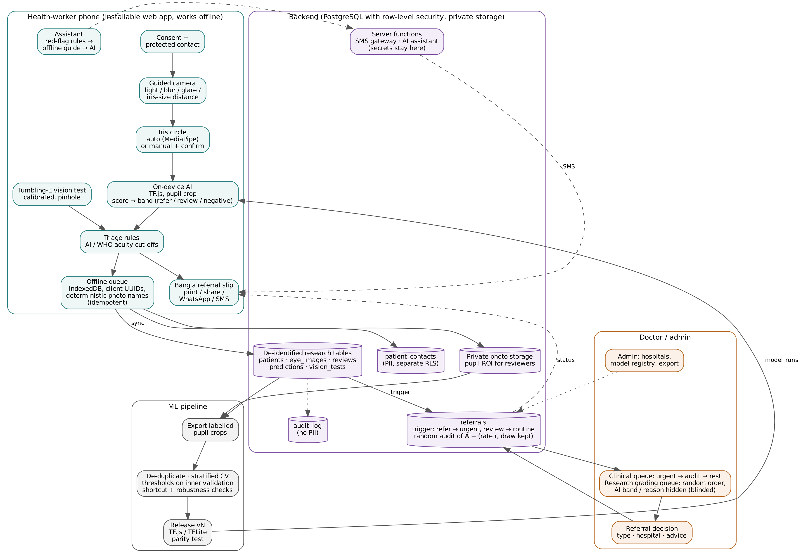

# Requirements, architecture and data model
# চাহিদা, কাঠামো ও ডেটা মডেল

**বাংলা:** কোন চাহিদা আগে (অগ্রাধিকার), সিস্টেমের চারটা অংশ কীভাবে যুক্ত, আর ডাটাবেসের কোন টেবিলে কে কী দেখতে পারে।

> Extracted from the paper (Netra AI, 2026). Table and section numbers refer to the paper; citations are omitted here — see the paper for references.

## Requirements

Four roles use the system: health workers (consent, photographs, vision test, referral slip, follow-up; low- or mid-range Android, often offline), ophthalmologists (labels and referral decisions), administrators (users, sites, hospitals, model versions, audit rate) and the research pipeline. Non-functional requirements were ranked so that the higher one wins in a conflict (Table 1).

| # | Requirement | Acceptance criterion used in this study |
|---|---|---|
| R1 | Offline first | 0 screenings lost and 0 duplicated under injected network faults (Section 2.10) |
| R2 | Privacy | names/phones only in a separate table; never in exports, audit log or short message service (SMS) texts; reviewers see only the pupil region |
| R3 | Low-cost phones | model ≤ 15 MB; inference < 1 s under 6× central processing unit (CPU) throttling (Section 2.6) |
| R4 | Trustworthy data | every score linked to model version and threshold; reference labels blinded; audit draw recorded |
| R5 | Scale | 1,000 workers × 20 patients/day without redesign; key queries < 100 ms at 200,000 patients |
| R6 | Speed for the worker | capture to submission < 2 min per patient (to be measured in the field) |

: Table 1. Requirements in priority order and acceptance criteria.

At 1,000 workers × 20 patients/day × 2 eyes, the system receives 40,000 photographs per day. Full photographs (≈400 KB) would need ≈16 GB/day; pupil crops and thumbnails need ≈2.2 GB/day. The average write load is below one screening per second, so the true bottleneck is ophthalmologist time: reviewing every eye at 30 s would need ≈333 doctor-hours per day, so the system must triage.

## System architecture

Figure 1 shows the four parts. The **client** is an installable React web application (one code base for phones and laptops, updates without an app store). It runs camera guidance, MediaPipe iris landmarks, the TF.js model, the vision test and an IndexedDB offline queue. The **backend** is PostgreSQL with row-level security (RLS), private object storage and server functions that hold secrets (SMS gateway, language-model key). **Doctor and administrator** views run in the same application under role gates; access control is enforced by RLS, never by the interface. The **machine learning (ML) pipeline** exports labeled pupil crops, de-duplicates, trains with cross-validation, chooses thresholds on inner validation data and releases versioned TF.js/TensorFlow Lite files that are registered in a `model_runs` table.

Research tables carry only a study identifier, age, sex, district and area; names, mobile numbers and addresses live only in `patient_contacts` (Table 2).

| Table | Purpose | Key access rule |
|---|---|---|
| patients | de-identified screening record | staff read; workers insert their own |
| eye_images | photo paths, pupil circle, capture checks, phone model | pupil crop visible to staff; full photo admin-only |
| predictions | score, band, threshold, model version per eye | band computed by trigger; doctors see a score only after labeling that eye |
| reviews | doctor label, confidence, blinded flag | doctors write their own |
| referrals | reason, type, priority, status, audit draw | workers may change only outcome fields; audit draw immutable |
| vision_tests | acuity, distance, calibration, pinhole, contrast | workers insert |
| patient_contacts | name, mobile, address (optional, consented) | admin, doctors, creating worker |
| model_runs, screening_config | model registry and thresholds; audit rate | admin writes |
| sms_log, audit_log | message status (last 4 digits); change history without personal data | admin/doctor read |

: Table 2. Data model and access rules (migrations 0000–0008).
