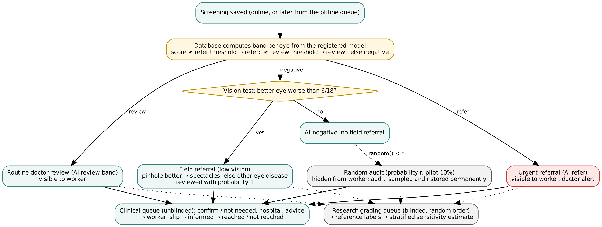

# Screening-to-referral logic, audit estimator and offline synchronization
# রেফারালের নিয়ম, অডিট আর অফলাইন সিঙ্ক

**বাংলা:** AI-এর স্কোর থেকে কীভাবে জরুরি রেফার, ডাক্তারের রিভিউ বা নেগেটিভ ঠিক হয়; নেগেটিভ রোগীর এলোমেলো অডিট দিয়ে কীভাবে মিস হওয়া ছানি মাপা হয়; আর নেট না থাকলে ডেটা কীভাবে নিরাপদে পরে যায়।

> Extracted from the paper (Netra AI, 2026). Table and section numbers refer to the paper; citations are omitted here — see the paper for references.

## Screening-to-referral logic in the data layer

**Two-tier band.** A database trigger computes each eye's band from the registered model run, so a stale or modified client cannot change it: score ≥ refer threshold → *refer* (urgent cataract referral, visible to the worker); score ≥ review threshold → *review* (routine doctor review); otherwise *negative* (Figure 3). For the deployed model the refer threshold is the conventional 0.5 and the review threshold is the sensitivity-first value chosen on validation data.

**Random audit and stratified estimator.** When the first prediction of a patient is negative, the trigger draws a random number and, with probability *r* (configurable; 10% during a pilot), creates a hidden audit referral that only doctors see. The draw (`audit_sampled`, `audit_p`) is stored permanently and cannot be changed by any later upgrade. AI-negative patients who receive a field referral for low vision are all reviewed. Field sensitivity at patient level is then estimated as

$$\hat{S} = \frac{TP}{TP + FN_{\mathrm{field}} + \sum_{i \in \mathrm{audit} \cap \mathrm{cataract}} 1/p_i},$$

where TP counts screen-positive patients with cataract, FN_field counts AI-negative patients with a field referral and cataract, and the sum runs over audit-sampled AI-negative patients without a field referral whose reference label is cataract (a stratified Horvitz–Thompson estimator). The database function `audit_sensitivity()` returns the estimate and its counts.

**Blinding.** If doctors know the AI result while labeling, their labels are biased towards the AI and cannot be used to measure it. Scores are hidden by RLS until the doctor has saved a label for that eye. In addition, reference labels are collected in a separate **research grading queue** that presents the research sample in a pseudo-random order without band, referral reason or priority; labels record whether they were made blinded. The clinical queue, which orders urgent referrals first, is used for patient care.

**Low vision.** A field referral is created from the phone through an idempotent function: better-eye acuity worse than 6/18 (WHO moderate visual impairment) is referred as spectacles if a pinhole improves it and otherwise as "other eye disease" (urgent); 6/18 is referred routinely for spectacles.

**Guard.** A trigger lets health workers change only outcome fields of a referral (informed, reached, not reached). It relies on the executing database role, which an application programming interface (API) client cannot change.

**Privacy by separation.** Contact details are optional, require a separate consent flag, are validated, and are readable only by administrators, doctors and the worker who entered them. They never appear in exports, training data or the audit log; SMS messages contain the study identifier and hospital but no name or score; the SMS log keeps the last four digits only. Non-admin reviewers can read only the pupil crop, and only after the circle has been confirmed.

## Offline-first synchronization

The design follows local-first principles, in which the device keeps a complete working copy and synchronizes when it can. Patient and eye identifiers are generated on the phone. If submission fails for network reasons, the complete screening (photographs, crops, contact, scores, vision results, field referral) is kept in IndexedDB and retried at start-up and when the browser reports that the network is back. Every step is safe to repeat: existing rows are detected and skipped, inserts ignore duplicates, the field referral is idempotent, and photographs use deterministic object names so that a retry reuses an object already stored. Because many phones may regain network at the same moment after a camp day (a *sync storm*), uploads start after a random delay of 0–30 s and each device retries on its own 45–75 s period.

## Field-sensitivity estimator: results

With the stratified estimator, bias was below 0.013 in every setting and below 0.001 from 5,000 patients. Precision depended mainly on the number of screened patients and the audit rate (Figure 6): with a 5% audit, the 95% half-width of the sensitivity estimate was ±0.17 at 300 patients, ±0.08 at 2,000 and ±0.03 at 20,000; a 10–20% audit reduced these to ±0.14–0.12, ±0.06–0.05 and ±0.020–0.015. With the earlier design (F3), sensitivity was overstated by +0.03, +0.07 and +0.11 when 25%, 50% and 75% of missed cataracts had low vision, independent of prevalence (Table 8).

| Share of missed cataracts with low vision | Earlier design (flag lost) | Stratified estimator |
|---|---|---|
| 25% | +0.034 | +0.001 |
| 50% | +0.070 | +0.001 |
| 75% | +0.108 | +0.000 |

: Table 8. Bias of the sensitivity estimate (true 0.85; prevalence 0.15 and 0.30 gave identical results to three decimals; 20,000 patients; 5% audit).

## Offline synchronization under faults: results

Across 3 × 1,000 screenings with 2,594, 6,992 and 35,702 injected faults (p = 0.05, 0.10, 0.20), every screening was eventually saved exactly once: 1,000 patients, 2,000 eye records, 1,000 contacts, 2,000 scores, 2,000 vision tests and 334 field referrals in every run, with no non-network errors. Mean attempts per screening were 3.5, 7.4 and 33.3 (maximum 13, 22 and 109). With random photo names, retries left 2,619, 5,428 and 17,185 orphan photo objects; with deterministic names, 0.
