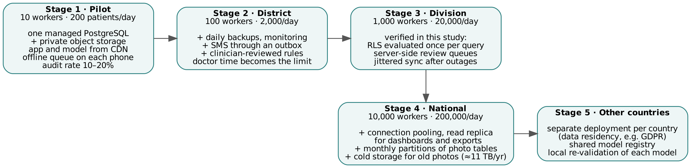

# Scalability, quality attributes, growth stages and trade-offs
# বড় হওয়ার সক্ষমতা, মান, ধাপে ধাপে বৃদ্ধি ও আপস

**বাংলা:** ১০ থেকে ১০,০০০ স্বাস্থ্যকর্মী পর্যন্ত সিস্টেম কীভাবে বাড়বে, কোথায় আসল সীমা (স্টোরেজ আর ডাক্তারের সময়), আর প্রতিটা সিদ্ধান্তে কী পেয়েছি আর কী ছেড়েছি।

> Extracted from the paper (Netra AI, 2026). Table and section numbers refer to the paper; citations are omitted here — see the paper for references.

## Scalability and doctor workload

| Operation | Before | After |
|---|---|---|
| Save one screening (patient, contact, 2 eyes, 2 scores + trigger, vision test) | 14.9 ms | 12.0 ms |
| Records page (20 patients) | 1.7 ms | 1.2 ms |
| Open-referral queue (50) + urgent count | 4,424 ms | 17.3 ms |
| Original review query (all confirmed photos) | 5,298 ms | 369 ms |
| Server-side `review_queue(20)` | did not exist | 21.3 ms |
| Dashboard and referral statistics | 422 ms | 434 ms |

: Table 9. Average latency before and after rewriting RLS policies (200,401 patients). A complete screening was saved at 668 transactions/s with eight clients, about 190 times the expected peak at 1,000 workers.

Table 10 converts out-of-fold band rates into doctor workload at 1,000 workers (40,000 eyes/day, 20% cataract prevalence among eyes, 10% audit of negatives, 30 s per review). Referring only at 0.5 flagged 28% of eyes (116 doctor-hours/day) and missed about 400 cataract eyes per day; adding the review band raised sensitivity to 98% for 13 more doctor-hours/day. Thresholds should therefore be chosen from ophthalmologist capacity as well as from validation sensitivity.

| Operating point | Sensitivity | Specificity | Eyes flagged | Doctor reviews/day (incl. 10% audit) | Doctor-hours/day (30 s) | Cataract eyes missed/day |
|---|---|---|---|---|---|---|
| Refer only (score ≥ 0.5) | 95% | 89% | 28% | 13,926 | 116 | 400 |
| Two-tier: refer ≥ 0.5, review ≥ Youden threshold | 98% | 88% | 30% | 14,656 | 122 | 160 |
| Two-tier: refer ≥ 0.5, review ≥ sensitivity-0.95 threshold | 98% | 85% | 32% | 15,427 | 129 | 160 |

: Table 10. Expected doctor reviews per day at 1,000 workers (40,000 eyes), from out-of-fold band rates of the deployable configuration, by prevalence of cataract among screened eyes.

## Quality attributes, growth stages and trade-offs

We evaluated the design against four quality attributes used in system design—scalability, availability, performance, and maintainability with cost (Table 11)—and planned growth in stages, adding components only when a stage needs them (Figure 7, Table 12). Database writes are not the limiting resource at any stage: even if all 200,000 screenings of a national day arrived within one hour (56 saves/s), the measured capacity of a 2-vCPU instance (668 saves/s) leaves a 12-fold margin. The limits are elsewhere: photograph storage at national scale (≈38 GB/day, ≈11 TB/year), and ophthalmologist time at every stage (Table 10).

| Attribute | Meaning for Netra AI | Design response | Evidence in this study |
|---|---|---|---|
| Scalability | more workers and patients without redesign | RLS evaluated once per query; server-side queues; indexes; sequence identifiers | 200,401-patient load test (Table 9); 12× margin at national sync storm |
| Availability | screening continues when network or server is down | on-device model; offline queue; idempotent writes and uploads; jittered retry | 0 lost / 0 duplicated under 35,702 injected faults (Section 3.9) |
| Performance | fast for worker and doctor | on-device inference; crops instead of full photos; review queue in the database | median inference 247 ms at 6× CPU throttling (WASM); key queries 1–21 ms |
| Maintainability and cost | small team, low budget | one web code base (no app store); managed PostgreSQL; rules as versioned migrations with tests | 29 database checks, 57 unit tests; storage ≈3.8 GB/day at 1,000 workers |

: Table 11. Quality attributes, design responses and evidence.

| Stage | Workers | Patients/day | Storage/day | Storage/year | Average saves/s | Sync-storm saves/s (1 h) | Margin vs measured |
|---|---|---|---|---|---|---|---|
| Pilot | 10 | 200 | 0.04 GB | 0.01 TB | 0.007 | 0.06 | 12,024× |
| District | 100 | 2,000 | 0.38 GB | 0.11 TB | 0.069 | 0.56 | 1,202× |
| Division | 1,000 | 20,000 | 3.8 GB | 1.14 TB | 0.694 | 5.56 | 120× |
| National | 10,000 | 200,000 | 38.0 GB | 11.4 TB | 6.944 | 55.56 | 12× |

: Table 12. Load by growth stage (20 patients per worker per day; 300 working days; measured capacity 668 saves/s on 2 vCPU).

Every design choice gave something up (Table 13); the guiding rule, as in general system design, was to meet today's need while keeping tomorrow's step possible.

| Choice | Gain | Cost | Decision |
|---|---|---|---|
| Pupil crops instead of full photographs | privacy, ≈7× less storage, no background shortcut | less context for a reviewing doctor | crops for every eye; full photographs for a 10% sample |
| Higher audit rate | more precise field sensitivity | more doctor reviews of negatives | 10–20% in pilot, lower at scale |
| Lower review threshold | fewer missed cataracts | more doctor reviews | two-tier band; urgent only above 0.5 |
| Blinded grading queue | unbiased reference labels | second workflow for doctors | separate research queue |
| On-device inference | works offline, no image leaves the phone | model size limited; updates need download | MobileNetV2 (≈9 MB), cached once |
| Web application instead of native | one code base, instant updates | less camera control, no native accelerator | web now; TensorFlow Lite file ready for native |
| Rules in the database | cannot be bypassed by a client | changes need migrations and tests | all safety rules in migrations with behavior tests |

: Table 13. Main trade-offs.
